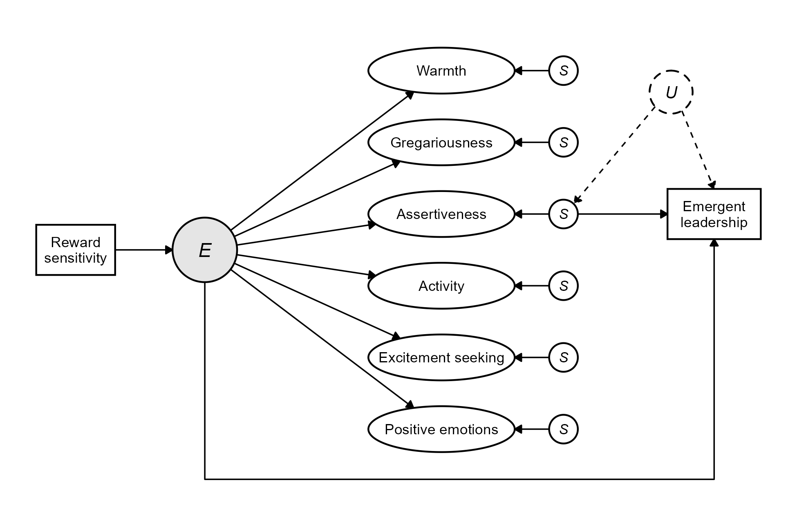

Grosz [-@groszWhyBigFive2026] proposes three shifts. The Big Five "are best understood as composites of personality items—not as real entities that cause item responses"; for description and prediction, composite-formative models should replace reflective ones; and causal research should move to narrower traits "assessed multimodally" (p. 1).

We agree with much of this. A Big Five domain is not a single biological, environmental, or mental entity that produces all item responses. Its items are not locally independent: some influence each other, some overlap semantically, and some share response styles [@leisingWhyJudgmentsDifferent2025]. Narrow traits measured with multiple methods are better targets for interventions than broad domains. Grosz does not claim that composites explain anything; he recommends them for description and prediction only.

Our disagreement concerns what remains once the simple reflective model is rejected. The target article dismisses hierarchical, bifactor, and exploratory structural equation models in two sentences: they "do not resolve the underlying ontological problem" because each "still presupposes underlying common causes that lack a clear correspondence in the real world" (p. 6). This is the step we question. Big Five domains are hierarchical. Facets share variance with their domain and also carry reliable variance of their own, which should not be mistaken for error [@cronbachCoefficientAlphaInternal1951; @zieglerTestingUnidimensionalityItems2015; @ziegler50FacetsTrait2016]. Rejecting a single common cause does not remove the shared part. Grosz himself attributes it to "shared genetic and environmental influences" and to direct effects among narrow traits, with semantic overlap and response styles adding covariance among items (pp. 4–5).

The relevant questions are quantitative. How much variance do the facets share? How much is reliable and specific to each facet? Which component carries the variance relevant to a given criterion? And what produces the shared part? To answer them, we keep three things apart: the decomposition of variance, its statistical representation, and its causal interpretation. The decomposition is descriptive. The causal interpretation is a hypothesis, which a hierarchical model can state and test but cannot establish by fitting the data.

## What a Domain Factor Represents

Grosz's Figure 1 depicts the model he rejects: many genetic and environmental causes act on one mental trait, which fully mediates their effects on the items. The model we defend has the same structure with a facet level in between. Some causes are shared across facets and act through the domain; others act on single facets; each item carries its own specific variance and error. On this reading, the domain factor stands for the part of the causes that the facets share, not for a single mechanism. In the words of @saucierHierarchicalSubcomponentsBig1999 [p. 625], extraversion "might well be conceived as that which sociability, unrestraint, assertiveness, and active adventurousness have in common."

This view is close to Thomson's bonds model of intelligence, in which tests correlate because they draw on overlapping sets of elementary causes [@bartholomewNewLeaseLife2009]. The bonds are causes: "some of these bonds are common to two tests and cause their correlation" (Thomson, 1951, p. 309, as cited in Bartholomew et al., 2009, p. 569). Read as a factor model, its general factor aggregates the bonds that tests share. It excludes the bonds that each test draws on alone. A weighted sum of test scores includes them, together with measurement error. The two are different variables, and only the second is a composite of indicators. The bonds model and the factor model cannot be distinguished statistically, and Thomson "had no objection to proceeding as if the factors were real" [@bartholomewNewLeaseLife2009, p. 568].

The same answer applies to the objection that a variable "constructed out of" its indicators cannot be their cause [@borsboomTheoreticalStatusLatent2003, p. 217]. On our reading, the domain factor is built from the causes of the facets, not from the facets. Latent variables of this kind are routine. The additive genetic factor in the twin studies discussed below stands for thousands of unmeasured variants. In causal graphs, @wysockiStatisticalControlRequires2022 [p. 11] recommend a variable U "to stand in for a set of nonspecific common causes."

This reading is a causal hypothesis, and it has a price. The arrows of a structural model encode causal assumptions; fitting the model tests some of their implications and establishes none of them [@bollenEightMythsCausality2013]. The assumption here is approximate proportionality: shared causes affect the facets in proportion to the facets' loadings on the domain. The effect of any single cause can be split into a proportional part and a facet-specific remainder, so the split alone tests nothing. The testable content is in the aggregate. If proportionality holds, the facet-specific components are uncorrelated, which restricts the facet covariance matrix when there are four or more facets. In twin data, it also requires the shared genetic and environmental influences to load on the facets in the same proportions. "Approximate" means that misfit attributable to these restrictions is small and local, judged against tolerances declared before the analysis. Good fit is necessary for the causal reading but not sufficient, because different causal structures can fit equally well [@haydukSeeingPerfectlyFitting2014; @rhemtullaWorseMeasurementError2020].

The hypothesis concerns differences between persons. A between-person causal account of this kind "can be defended" even though it licenses no claim about processes within individuals [@borsboomTheoreticalStatusLatent2003, p. 211]. Within-person processes are the object of process theories. Whole Trait Theory separates stable distributions of states from the mechanisms that produce them [@fleesonWholeTraitTheory2015], and Cybernetic Big Five Theory attributes each level of the trait hierarchy to variation in specific mechanisms [@deyoungCyberneticBigFive2015].

## What the Evidence Shows

Grosz cites two twin studies as showing that genetic and environmental influences on the Big Five are not fully mediated by higher order traits. Read in full, they show something more specific. @brileyBroadBandwidthHigh2012 tested the structure described above: shared genetic and environmental influences acting through the domain, plus facet-specific influences. This common-pathway model was retained for extraversion and openness. It was rejected for agreeableness, for neuroticism, and, at the margin (*p* = .05), for conscientiousness (pp. 753–756). Retaining a model does not confirm it. The point is that the restriction could fail, and for three domains it did. The target article reports the result accurately as holding for "three of the five domains" (p. 4); two pages later, the qualifier is gone (p. 6). @franicBigFivePersonality2014 tested a model without facets, in which five domains fully mediate the genetic and environmental influences shared by 60 items. That model was rejected, as we would also expect. Yet the genetic and the environmental covariance matrices both showed a five-factor structure, and the authors considered that full mediation, although not exactly true, may "provide a reasonable approximation to the generating model" (p. 602).

The evidence is therefore specific to each domain and to each restriction. Shared etiology organized at the domain level is well documented. Full mediation without a facet level is not. Proportional action through the domain is retained for some domains and rejected for others. This is what a testable hypothesis looks like. The hierarchy has also been revised when the data required it: two genetic factors per domain led to an aspect level between domains and facets [@deyoungFacetsDomains102007; @deyoungCyberneticBigFive2015].

Measured candidate causes enter the same model. The target article names reward-related processing as one of several mechanisms underlying extraversion (pp. 5–6). In the study it cites [@smillieExtraversionRewardprocessing2019], an electrophysiological index of reward processing correlated .26 with extraversion, .21 with its agentic aspect, and .19 with its affective aspect. Neither aspect predicted it once the other was controlled (partial *r* = .16 and .12). With 100 participants, this is far from conclusive. It is, however, the pattern expected from a cause acting on what the two aspects share. A correlation of .26 also leaves most of the shared variance unexplained, so a model that includes reward processing still needs a representation of the rest. Moreover, testing whether a measured cause acts proportionally on the facets requires their loadings on a shared component. Such a test belongs within a hierarchical model; it is not an alternative to it.

Interventions are the second source of evidence. In @olaruPersonalityChangeDigitalcoaching2024, a digital coaching intervention increased self-reported sociability (*d* = 0.89–1.00) but not assertiveness (*d* = 0.12–0.15). Observers reported the reverse: an increase in assertiveness (*d* = 0.40 at follow-up) and no significant change in the other facets. Grosz reads this as showing that Big Five traits cannot be manipulated "as unified entities" (p. 5). His own description of the reflective model predicts the pattern: an increase in French due to tutoring is "not expected to alter the general intelligence or affect other subjects" (p. 3). An intervention built on concrete behaviors, as this one was, is expected to change facet-specific variance. The result constrains one claim, namely that the intervention changed extraversion. It does not bear on whether domain-common variance exists. Intelligence offers a parallel: secular gains in test scores are not factorially invariant across cohorts [@wichertsAreIntelligenceTests2004], which places them below the level of *g* and says nothing against a general factor within cohorts. Olaru et al. located change with measurement invariance tests across the levels of the trait hierarchy, which is the decomposition we propose.

Separability raises the same issue. Grosz argues that extraversion cannot be a common cause because it "cannot be identified, measured, or manipulated independently of its constituent narrow traits" (p. 4), whereas talkativeness can be the common cause of self-reports, informant reports, and audio recordings (p. 5). Yet talkativeness is made of speaking episodes, as extraversion is made of narrow tendencies: someone who never talks cannot be talkative. The difference is one of breadth, not of kind. Separability matters for defining a treatment. It does not decide whether variation across components has shared causes.

## What Composites Keep and What They Lose

Composites are legitimate summaries, and Grosz claims no explanatory role for them. The composite-formative model "makes no assumptions about causal effects from or on the indicators" (p. 7). It therefore cannot be causally misspecified, just as a definition cannot be false. Nor can it be tested: as a measurement model, it "yields perfect fit" (p. 9). It says nothing about how the data were generated.

Composite indicators need not be correlated [@bollenThreeCsMeasurement2011]. For the Big Five, however, Grosz notes that correlated items are what make the composites efficient summaries (p. 7). The covariance is the reason these composites exist. What a composite cannot tell is how much of its variance is shared across facets, how much is reliable and facet-specific, and how much is error. It fuses the three.

The simulation in the target article shows the cost. Six items correlate .25 with each other and .15 with an outcome, and item retest reliability is set to .68 (p. 8). In this population, the outcome correlates .26 with the reliability-corrected composite and .30 with the common factor. Grosz describes the second value as an overcorrection. The two values estimate different quantities. The first is the correlation of the outcome with the composite's true score, which includes reliable item-specific variance; the second is its correlation with the variance the items share. Because every item has the same correlation with the outcome, these data cannot tell whether the reliable item-specific variance contributes anything to it. The reflective value assumes that it does not; the composite value mixes both sources. Neither is a correction of the other, and which one is wanted depends on the question.

The cost grows when the components relate differently to a criterion. Domain-common and facet-specific associations can differ in size and even in sign. When a model omits the specific associations, the estimated domain association can be severely biased, sometimes with the wrong sign [@moshagenWhenTrulyPositive2023]. Facets that predict an outcome in opposite directions therefore do not show that only facets matter; their contributions must be estimated jointly with the common one. In research on cognitive abilities, where the nature of *g* is still debated [@vandermaasDynamicalModelGeneral2006], general and specific abilities are modeled together and the criterion decides which level matters [@schneiderCattellHornCarrollTheory2018].

Local dependence adds a further cost. If enthusiasm increases talkativeness, a sum of enthusiasm and talkativeness items counts the upstream process twice, once directly and once through its consequence. This is not an error of the composite, which makes no causal claim. It makes the score harder to interpret for any question about process.

## A Specified Model for Extraversion

We now specify one model for one domain (@fig-model). We choose extraversion, the domain for which the common-pathway model was retained, and the six NEO facets: warmth, gregariousness, assertiveness, activity, excitement seeking, and positive emotions. The number of facets matters. With the three facets of the BFI-2 [@sotoNextBigFive2017], a second-order factor is just-identified, and its central restriction cannot be tested from the facet covariances.

Each facet is measured by self- and informant reports. Items load on their facet, and facets load on a domain factor E, which stands for the hypothesized shared part of the causes of the six facets. Each facet has a specific component S, uncorrelated with E and with the other specific components. One method factor per rater, uncorrelated with all other factors, absorbs variance specific to that rater, such as acquiescence in self-reports. Without it, response styles would enter E. Item residuals are independent, except for pairs declared in advance, such as near-paraphrases or reverse-keyed items. The six facets have 21 variances and covariances; the second-order structure uses 12 parameters, which leaves 9 degrees of freedom to test the proportionality restriction.

The model assumes no direct effects among facets. This is a substantive choice. If assertiveness made people more active, part of the covariance between the two facets would reflect that effect, not shared causes. Cross-sectional data cannot separate the two. Longitudinal data can help, because a direct effect implies that change in one facet precedes change in the other.

A measured candidate cause, reward sensitivity assessed independently of the questionnaire, predicts E. Direct paths from reward sensitivity to the specific components test whether its effects are proportional. The criterion is emergent leadership in a leaderless group task, rated by observers. Among the Big Five, extraversion is the most consistent correlate of leadership across settings and criteria [@judgePersonalityLeadershipQualitative2002]. We expect two paths: one from E, for broad social engagement, and one from the assertiveness-specific component, for speaking up and taking charge. The other specific paths are fixed to zero. These zeros are substantive hypotheses, and they are also required: with one criterion, the paths from E and from all six specific components cannot be estimated together [cf. @eidBifactorModelsPredicting2018].

::: {#fig-model apa-note="E = domain-common component, standing for the hypothesized shared part of the causes of the six facets. S = facet-specific components. Each facet is measured by self- and informant-report items, with one method factor per rater (not shown). Paths from reward sensitivity to the specific components are fixed to zero and freed one at a time to test proportionality. Paths to the criterion from the specific components other than assertiveness are fixed to zero. U (dashed) is an unmeasured cause of assertiveness-specific variance and of the criterion."}

A Hierarchical Model for Extraversion
:::

The model is compared with three alternatives: freely correlated facets without a domain factor, which is what entering the facets as separate predictors amounts to; a common-only model, in which the facet–criterion associations must be proportional to the facet loadings; and a specific-only model. Tolerances are declared before the analysis: a maximum residual correlation among the specific components, a minimum hierarchical omega for E, and a smallest effect of interest for each path. The model can fail in three ways, with different consequences. First, if residual correlations among the specific components exceed the tolerance beyond the pairs declared in advance, and replicate, one domain factor does not represent these facets in this population. The hierarchy must then be revised, for example with aspects, or abandoned for this instrument. Second, if the path from E is below the smallest effect of interest, the facet level is the relevant one for this criterion. Third, if reward sensitivity acts mainly through direct paths to single facets, it is not a domain-level cause. One failure of the second or third kind does not count against the domain factor. Many do. A factor that predicts no criterion beyond its facets and through which no measured cause acts has no substantive content, and we would stop interpreting it. We would also abandon it if hierarchical omega fell below the tolerance, that is, if the facets shared little variance across raters. Modifications suggested by the data are new hypotheses for new data; they do not rescue the original specification. The lavaan syntax, with a check on simulated data, is available at [OSF link]. A composite can fail none of these tests, because it makes none of these claims.

## Causal Inference

We agree with Grosz that broad domains are poor treatment variables. An intervention on extraversion as a whole is hard to define, and different ways of changing it may have different effects [@vanderweeleConstructedMeasuresCausal2022]. Whether to adjust for a domain depends on a causal graph that the measurement model does not provide [@wysockiStatisticalControlRequires2022]. Within a specified graph, however, the domain factor can do useful work.

Suppose the target is the effect of assertiveness on emergent leadership in @fig-model. E affects both assertiveness and the criterion, which opens a backdoor path between them. So does any shared cause of the facets that also affects the criterion. If the shared causes affect assertiveness only through E, adjusting for E blocks all of these paths, without measuring the causes one by one and whatever their effects on the criterion. What remains is the path from the assertiveness-specific component S to the criterion, which is the effect the model estimates. This is what proportionality buys for causal inference: it is the condition under which adjustment at the domain level suffices against confounding by shared causes. Departures from it act as facet-specific confounders. A cause U with an additional effect on assertiveness, for example prior leadership experience, leaves the path through U open. No measurement model closes it, and fit does not reveal it, because the association it creates is absorbed by the estimated path from S to the criterion. U must be measured, handled by design, for example with longitudinal data, or bounded by a sensitivity analysis.

This argument concerns E as estimated within the structural model, not a score computed from the items. A factor score, like a composite, is a weighted sum of items. Adjusting for it means adjusting for a proxy that contains facet-specific variance and error, which leaves residual confounding [@westfallStatisticallyControllingConfounding2016]. Control variables must be measured without error, or "a model that deals with the measurement error must be used" [@wysockiStatisticalControlRequires2022, p. 3]. Correcting a composite for unreliability does not solve the problem, because its reliable variance still includes facet-specific variance. If facets affect each other, a composite of them also contains consequences of the exposure; adjusting for it can remove part of the effect or open a collider path. In @fig-model, E is a parent of the facets, not a descendant, but only because the model assumes no direct effects among facets. If assertiveness affects other facets, the estimated E absorbs part of those consequences, and the problem returns. All of this holds only if the model is correct, which fit cannot guarantee.

## Conclusion

Grosz is right about the simple reflective model. A Big Five domain is not one entity, and its items are not locally independent. The conclusion that the domains are composites does not follow. The facets share variance, and the shared variance has causes. A hierarchical model separates it from facet-specific variance and from error, and states where the shared causes are assumed to act. That statement can fail, and for some domains it has. A composite cannot fail, because it states nothing. It remains a useful summary, but it leaves open which level of the hierarchy matters for a given outcome, and why the facets covary. @saucierHierarchicalSubcomponentsBig1999 [p. 625] described a broad factor as "not so much one thing as a collection of many things that have something in common." The something in common is what we propose to model.

# Declarations

- **AI use**: The authors used ChatGPT and Codex (OpenAI) and Claude (Anthropic) to identify weaknesses, check sources, and edit the English. The authors reviewed all suggestions and take full responsibility for the content.

- **Funding**: The authors received no funding for this study.

- **Conflict of interest**: The authors have no conflict of interest to declare.

- **Ethics approval**: Not applicable.

- **Consent to participate**: Not applicable.

- **Consent for publication**: Not applicable.

- **Availability of data, code, and materials**: No data were collected. The lavaan syntax for the model in @fig-model, with a check on simulated data, and the code for the figure are available at [OSF link].

# References
